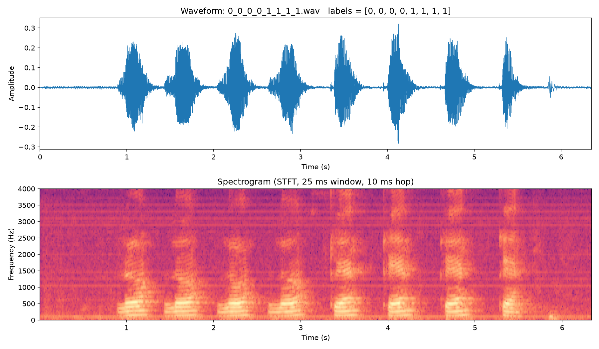
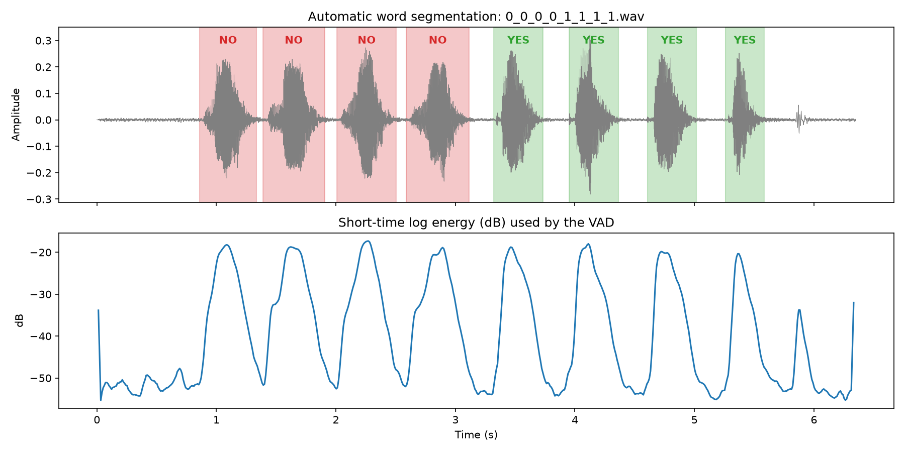
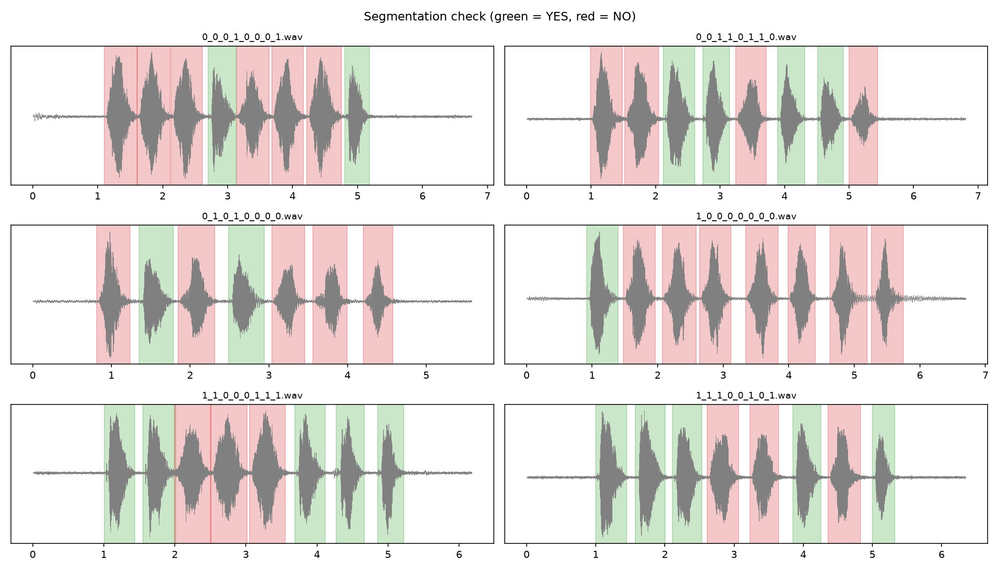
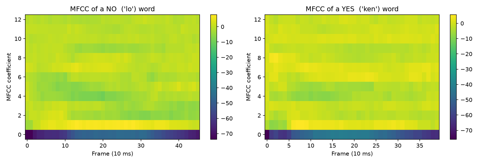
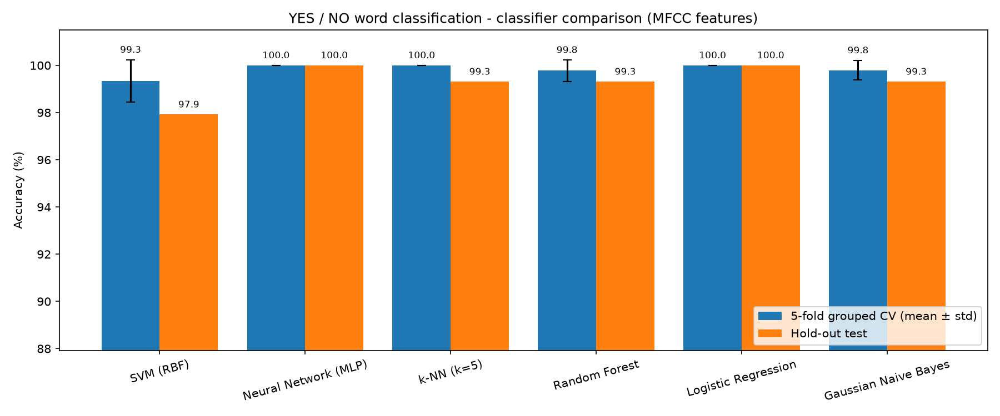
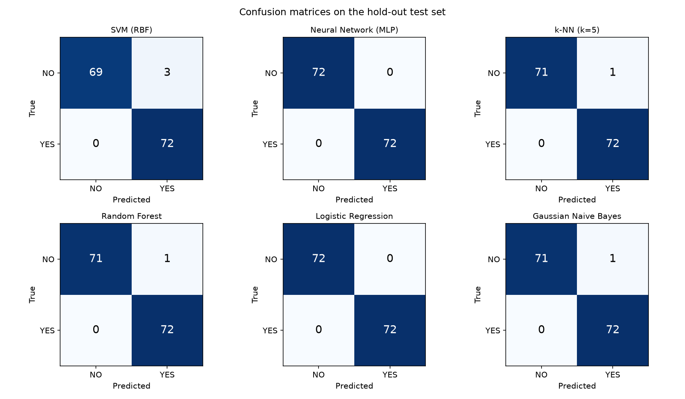

# Mini-Task 8 — Yes/No Spoken Word Classification

**Course:** Digital Speech Processing — Dr. Mohammad Khalooei, Amirkabir University of Technology (AUT)
**Student:** Kawther Algharban — 403231102
**Date:** November 2026

---

## 1. Task

Train and compare at least four classifiers (including an SVM and a neural network) that recognise whether a spoken word is **"yes"** or **"no"**, using the **YesNo** dataset (the dataset available in `torchaudio.datasets.YESNO`).

## 2. Dataset

| Property | Value |
|---|---|
| Source | OpenSLR #1 (the same files used by `torchaudio.datasets.YESNO`) |
| Recordings | 60 `.wav` files, one male speaker, Hebrew |
| Words per recording | 8 — each is *"ken"* (yes) or *"lo"* (no) |
| Labels | encoded in the file name, e.g. `0_1_1_0_0_1_1_0.wav` → no, yes, yes, no, no, yes, yes, no |
| Sample rate | 8000 Hz (so the highest frequency that can be represented is 4000 Hz, by the Nyquist limit) |
| Duration | 4.94 – 6.98 s (mean 6.13 s) |
| Total words | 480 (yes = 251, no = 229), so the two classes are almost balanced |



**Observation.** The waveform shows eight well-separated bursts of energy, one per word, with silence between them. In the spectrogram, every *"ken"* (yes) begins with a short vertical stripe of energy that reaches up to 4 kHz: this is the release burst of the plosive **/k/**. Every *"lo"* (no) begins with the voiced consonant **/l/**, which has its energy mostly below 2.5 kHz. This spectral difference is what the classifiers learn.

## 3. Method

```
wav ─► framing (25 ms, hop 10 ms) ─► short-time energy ─► VAD / word segmentation (8 words)
    ─► pre-emphasis ─► Hamming window ─► FFT ─► 26 Mel filters ─► log ─► DCT ─► 13 MFCC + 13 Δ
    ─► mean & std over time (52 features per word) ─► standardisation ─► classifier
```

### 3.1 Word segmentation (simple VAD)

The labels belong to the whole file, so each recording must first be cut into its 8 words.

* **First attempt — one global energy threshold.** The number of segments was often correct, but the segments were wrong. In some files two close words were merged, and a click at the end of the recording was counted as a word. As a result the labels were shifted by one position. This was caught only by **plotting the segmentation**.
* **Final method — energy peak picking.** Every word is one "hill" of the log-energy curve. The 8 highest local maxima (each the highest point within ±200 ms) are kept, so clicks and breaths, which are about 15 dB weaker, are ignored. The boundary between neighbouring words is the energy minimum between them. Each word is then trimmed to the frames whose energy is above the noise floor plus 30% of that word's dynamic range.




**Result:** 59 of 60 files were segmented into exactly 8 words. The file `0_1_0_1_0_0_0_0.wav` contains only **7 audible energy bursts**; two words appear to be spoken without a pause between them. Because its labels cannot be aligned reliably, this file was excluded. Final data: **472 words** (yes = 249, no = 223).

### 3.2 Features

MFCCs were implemented step by step in NumPy, following the course's Signal Lab pipeline:

* pre-emphasis (0.97), 25 ms Hamming window, 10 ms hop, 256-point FFT, 26 triangular Mel filters, log, DCT → 13 coefficients
* delta coefficients (±2 frames)
* each word becomes a fixed-length vector: the **mean and standard deviation** of the 26 coefficient tracks → **52 features**



### 3.3 Evaluation protocol

* **Grouped splitting:** words from the same recording are never placed in both train and test (`GroupKFold`, `GroupShuffleSplit` on the recording id). This prevents the model from recognising the recording rather than the word.
* **5-fold grouped cross-validation** → mean ± std accuracy.
* **Hold-out split:** 41 files (328 words) for training and 18 files (144 words) for testing → accuracy, precision, recall, F1 and confusion matrix.
* Every model is a pipeline `StandardScaler → classifier`, so the scaler is fitted on the training folds only.

## 4. Classifiers

| # | Model | Main settings |
|---|---|---|
| 1 | **SVM** | RBF kernel, C = 10, γ = "scale" |
| 2 | **Neural Network (MLP)** | 2 hidden layers (64, 32), ReLU, Adam |
| 3 | k-Nearest Neighbours | k = 5 |
| 4 | Random Forest | 200 trees |
| 5 | Logistic Regression | L2 regularisation |
| 6 | Gaussian Naive Bayes | — |

## 5. Results

| Model | CV accuracy (mean ± std) | Test accuracy | Precision | Recall | F1 | Train time (s) |
|---|---|---|---|---|---|---|
| SVM (RBF) | 99.34 ± 0.90 % | 97.92 % | 0.960 | 1.000 | 0.980 | 0.001 |
| **Neural Network (MLP)** | **100.00 ± 0.00 %** | **100.00 %** | **1.000** | **1.000** | **1.000** | 0.027 |
| k-NN (k = 5) | 100.00 ± 0.00 % | 99.31 % | 0.986 | 1.000 | 0.993 | 0.001 |
| Random Forest | 99.77 ± 0.45 % | 99.31 % | 0.986 | 1.000 | 0.993 | 0.096 |
| **Logistic Regression** | **100.00 ± 0.00 %** | **100.00 %** | **1.000** | **1.000** | **1.000** | 0.001 |
| Gaussian Naive Bayes | 99.79 ± 0.42 % | 99.31 % | 0.986 | 1.000 | 0.993 | 0.001 |

*(Precision, recall and F1 are reported for the class YES.)*




## 6. Discussion

1. **The task is easy for every model.** All six classifiers exceed 97.9% test accuracy. The two words differ strongly in their acoustics (the /k/ burst against the voiced /l/), there is only one speaker, and the recordings are clean. With 52 MFCC statistics the two classes are almost **linearly separable**, which is why even a linear model (Logistic Regression) reaches 100%.
2. **Best models:** the MLP and Logistic Regression made no errors in either cross-validation or the hold-out test. Logistic Regression is the better practical choice here because it reaches the same result as the MLP, trains about 27 times faster and is easier to interpret.
3. **All errors have the same type: NO predicted as YES.** The recall for YES is 1.000 for every model. The few false "yes" predictions are probably *"lo"* segments whose boundaries include a little noise or part of a neighbouring onset. This points to the **segmentation, not the classifier**, as the remaining source of error.
4. **SVM** was the weakest (3 errors, the largest CV variance). The RBF hyper-parameters (C, γ) were not tuned; a grid search would very likely close this gap.
5. **Segmentation was the critical step.** A wrong VAD shifts every label after the error, which silently corrupts the training data. Plotting the segmentation was essential.
6. **Limitations:** a single speaker, a single language and clean audio. The near-perfect scores would not carry over to new speakers or noisy recordings. Testing that requires multi-speaker data such as Speech Commands, or adding noise, for example from VOiCES as in the next mini-task.

## 7. How to run

```bash
pip install -r requirements.txt
python step1_explore.py              # downloads the data, prints statistics, plots waveform + spectrogram
python step2_segment_features.py     # VAD segmentation + MFCC features -> features/yesno_features.npz
python step3_train_classifiers.py    # trains 6 classifiers, prints the table, saves the figures
```

The dataset is downloaded automatically into `data/` (it is not stored in the repository).

## 8. Files

```
MiniTask08_YesNo/
├── README.md                     this report
├── requirements.txt
├── step1_explore.py              data loading and exploration
├── step2_segment_features.py     VAD segmentation + MFCC (NumPy implementation)
├── step3_train_classifiers.py    training and comparison of 6 classifiers
├── figures/                      all plots used in this report
└── results/results_table.csv     numerical results
```
