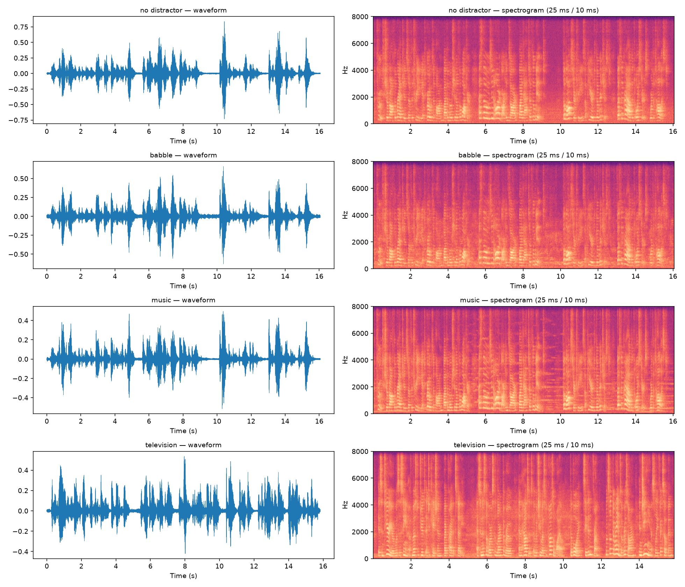
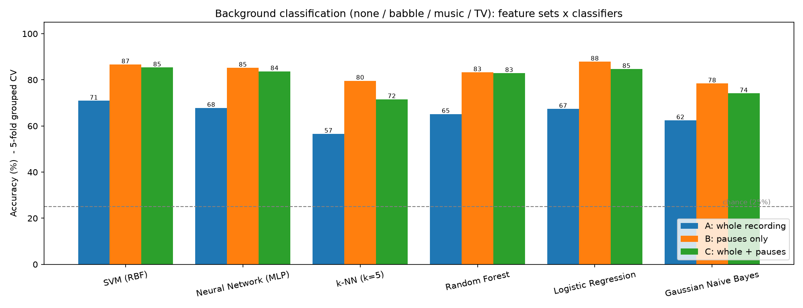
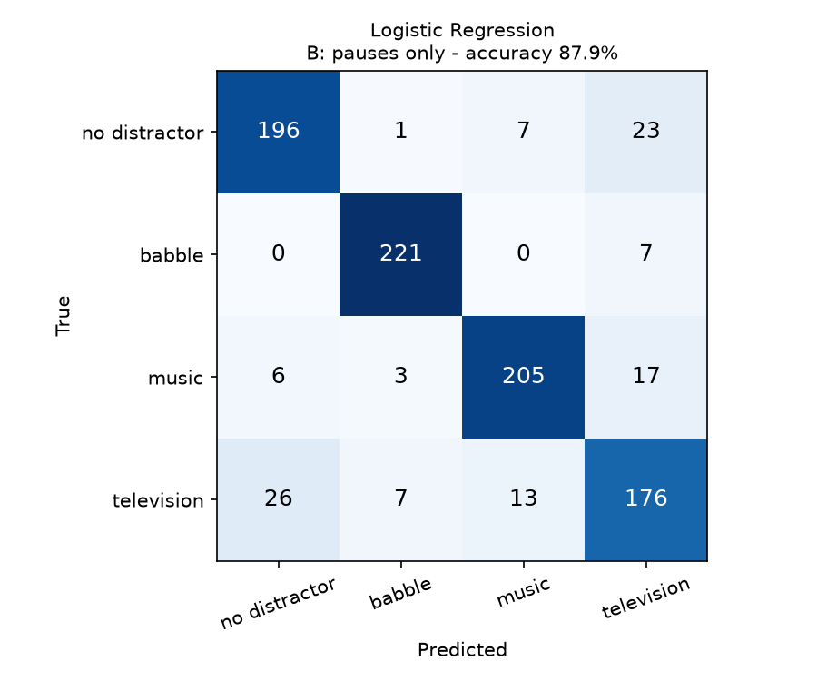
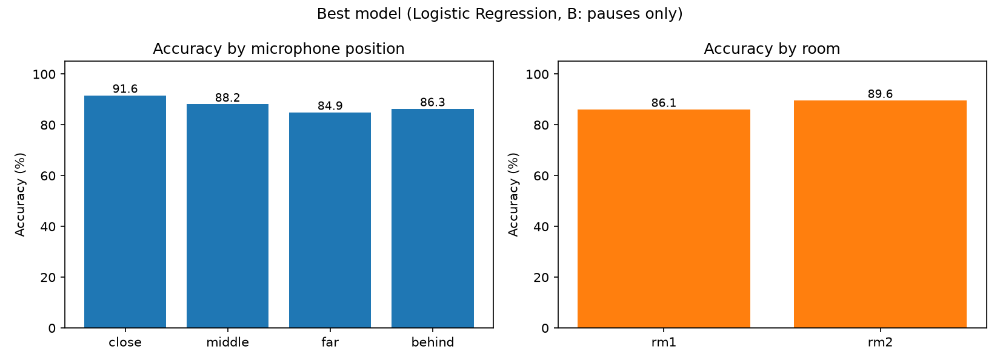
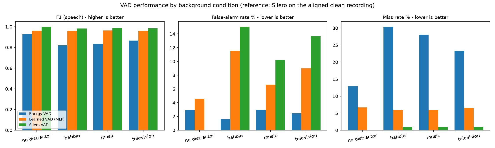
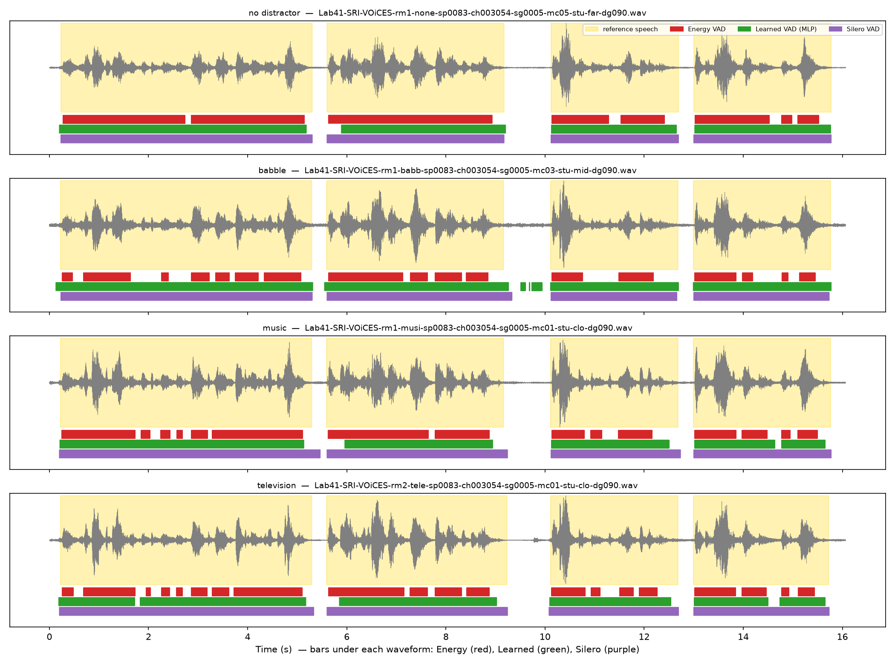

# Mini-Task 9 — Background/Event Classification and Voice Activity Detection on VOiCES

**Course:** Digital Speech Processing — Dr. Mohammad Khalooei, Amirkabir University of Technology (AUT)
**Student:** Kawther Algharban — 403231102
**Date:** November 2026

---

## 1. Task

Use the **VOiCES** dataset (Voices Obscured in Complex Environmental Settings) to build:

1. **Event / background classification**: recognise which background sound is playing in a recording.
2. **Voice Activity Detection (VAD)**: decide for every 10 ms frame whether it contains speech, and measure how background sounds affect different VAD methods.

## 2. Dataset

The 90-degree subset recommended for limited resources (`github.com/Lab41/VOiCES-subset`) was used.

| Property | Value |
|---|---|
| Recordings | 908 `.wav` files (about 3.9 hours) |
| Sample rate | 16 kHz, 16-bit |
| Duration | 2.7 – 19.1 s (mean 15.6 s) |
| Content | LibriSpeech sentences replayed by a loudspeaker in real rooms and recorded by distant microphones |
| Background (distractor) | none 227 · babble 228 · music 231 · television 222 (balanced) |
| Rooms | rm1 (446), rm2 (462) |
| Microphone position | close 251 · middle 211 · far 219 · behind 227 |
| Speakers / sentences | 104 speakers, 128 different sentences |



**Observation.** The same sentence is replayed in every condition, so the speech looks almost identical with and without a distractor. The difference is in the **pauses between words**: they are quiet with no distractor and filled with noise when babble, music or TV is playing. This observation drives both parts of the task.

**Practical issue solved.** The archives store absolute paths of the original author's computer (`/Users/...`), so a normal `extractall()` fails with *Permission denied*. Only the `.wav` files are extracted into `data/VOiCES-subset/audio/`. Interrupted downloads are written to `.part` files and incomplete archives are detected and downloaded again.

## 3. Features (shared, `audio_features.py`)

For each 25 ms frame (10 ms hop): 13 MFCCs (NumPy implementation, 40 Mel filters), log energy, spectral centroid, bandwidth, 85% roll-off, spectral flatness and zero-crossing rate — **19 features per frame**.

## 4. Part 1 — Background classification (none / babble / music / TV)

### Method
* Three feature sets (mean + std of the 19 frame features → 38 values each):
  * **A — whole recording**: all frames
  * **B — pauses only**: the 25% lowest-energy frames, where the background dominates
  * **C — A + B**
* Six classifiers: SVM (RBF), Neural Network (MLP), k-NN, Random Forest, Logistic Regression, Gaussian Naive Bayes.
* **5-fold GroupKFold grouped by sentence**: the same sentence is never in both training and test data, so the model cannot memorise the speech.

### Results (accuracy, 5-fold grouped CV; chance = 25%)

| Model | A: whole | **B: pauses only** | C: whole + pauses |
|---|---|---|---|
| SVM (RBF) | 70.9 % | 86.7 % | 85.4 % |
| Neural Network (MLP) | 67.8 % | 85.2 % | 83.7 % |
| k-NN (k = 5) | 56.6 % | 79.6 % | 71.6 % |
| Random Forest | 65.2 % | 83.3 % | 82.9 % |
| **Logistic Regression** | 67.4 % | **87.9 %** | 84.7 % |
| Gaussian Naive Bayes | 62.4 % | 78.4 % | 74.1 % |

Best model: **Logistic Regression on pause frames — 87.9 % accuracy, macro-F1 0.878.**

| Class | Precision | Recall | F1 |
|---|---|---|---|
| no distractor | 0.860 | 0.863 | 0.862 |
| babble | 0.953 | 0.969 | 0.961 |
| music | 0.911 | 0.887 | 0.899 |
| television | 0.789 | 0.793 | 0.791 |

Accuracy by microphone: close 91.6 % · middle 88.2 % · behind 86.3 % · far 84.9 %. By room: rm1 86.1 % · rm2 89.6 %.





### Discussion
1. **Listening to the pauses is the key.** Pause-only features improve every classifier by 15–23 points. For this task the foreground speech is a nuisance: it is the same in all classes and masks the background.
2. **Adding the whole-recording features (C) does not help.** The speech statistics add variance without adding class information.
3. **Babble is the easiest class** (recall 0.97) because it is continuous. **Television is the hardest** (0.79): it contains quiet moments, speech and music, so it is confused with *no distractor* (26 files) and *music* (13).
4. **Distance matters.** Accuracy drops from 91.6 % (close microphone) to 84.9 % (far), because reverberation smears the background characteristics.

## 5. Part 2 — Voice Activity Detection

### Building a reference
VOiCES has no frame-level speech labels. Every sentence, however, was also recorded **without a distractor**. So:
1. **Silero VAD** is run on the clean recording of the sentence.
2. Each noisy recording is **aligned** to a clean recording of the same sentence by cross-correlating energy envelopes (±1 s search; same room and microphone preferred).
3. The clean speech labels are copied to the noisy recording. Matches with correlation < 0.5 are rejected.

Result: **860 of 908 recordings** aligned (48 skipped, mostly sentences with no clean version), median lag 10 ms, median correlation **0.94**. In total 1.33 million frames, **85.6 % speech**.

### Compared methods
| Method | Description |
|---|---|
| Energy VAD | Threshold on smoothed log energy (noise floor + 35 % of the dynamic range) + 210 ms majority smoothing |
| Learned VAD (MLP) | Neural network on 19 frame features + 110 ms context; 3-fold GroupKFold by sentence; trained on a **balanced** sample of speech / non-speech frames |
| Silero VAD | Pre-trained neural VAD (`github.com/snakers4/silero-vad`) run directly on the noisy recording |

### Results

| Condition | Method | Accuracy | F1 | False alarm | Miss |
|---|---|---|---|---|---|
| no distractor | Energy VAD | 88.6 % | 0.928 | 2.9 % | 12.9 % |
| | Learned VAD (MLP) | 93.6 % | 0.961 | 4.6 % | 6.7 % |
| | Silero VAD | *100 % (reference itself)* | — | — | — |
| babble | Energy VAD | 73.7 % | 0.819 | 1.6 % | 30.4 % |
| | Learned VAD (MLP) | 93.3 % | 0.960 | 11.5 % | 5.9 % |
| | Silero VAD | 97.1 % | 0.983 | 15.0 % | 0.9 % |
| music | Energy VAD | 75.6 % | 0.834 | 3.0 % | 28.1 % |
| | Learned VAD (MLP) | 94.0 % | 0.964 | 6.6 % | 5.9 % |
| | Silero VAD | 97.7 % | 0.987 | 10.2 % | 1.0 % |
| television | Energy VAD | 79.6 % | 0.866 | 2.5 % | 23.3 % |
| | Learned VAD (MLP) | 93.1 % | 0.959 | 9.0 % | 6.5 % |
| | Silero VAD | 97.3 % | 0.984 | 13.6 % | 0.9 % |
| **all noisy** | Energy VAD | 76.2 % | 0.840 | 2.3 % | 27.4 % |
| | Learned VAD (MLP) | 93.5 % | 0.961 | 9.1 % | 6.1 % |
| | **Silero VAD** | **97.4 %** | **0.985** | 13.0 % | **0.9 %** |

*False alarm = non-speech frames marked as speech; miss = speech frames marked as non-speech.*




### Discussion
1. **Energy VAD fails in noise by missing speech.** The background raises the energy floor, so the threshold rises and quiet parts of speech (unvoiced consonants, word endings) fall below it: the miss rate jumps from 12.9 % (clean) to 27–30 %. Its false-alarm rate stays low, so it is a conservative detector. Babble hurts it most because babble is continuous energy in the speech band.
2. **The learned VAD is robust to the background type** (F1 ≈ 0.96 in all four conditions) because it uses spectral shape (MFCCs, flatness, centroid) and context, not only energy. Training on a balanced sample was necessary: the first version, trained on the natural 85 % / 15 % mix, labelled most pauses as speech (34 % false alarm on babble).
3. **Silero VAD is the best** (F1 0.985, miss < 1 %). Its false alarms (10–15 %) occur mostly at the edges of words and in short pauses: Silero keeps segments open slightly longer, and with only 14 % non-speech frames a few hundred milliseconds per pause weigh heavily.
4. **Limitation of the evaluation.** The reference is itself produced by Silero (on the clean recording), so the comparison favours Silero. Even so, Silero on noisy audio disagrees with Silero on clean audio by about 3 % of frames, which measures the effect of the distractor on it. A reference made by human annotation or forced alignment of the LibriSpeech transcripts would give a fairer comparison.

## 6. Conclusion
* **Background classification:** the background is recognised from the **pauses**, not from the speech. Logistic Regression on pause frames reaches 87.9 % (chance 25 %). Television is the hardest class, and close microphones give the best results.
* **VAD:** a simple energy detector loses about a quarter of the speech in noise. A small neural network with spectral features is far more robust (F1 0.96), and the pre-trained Silero VAD is the best (F1 0.985).

## 7. How to run

```bash
pip install -r requirements.txt
python step1_explore_voices.py            # downloads ~380 MB, extracts, statistics + plots
python step2_background_classification.py # part 1: background classification
python step3_vad.py                       # part 2: VAD comparison (Silero, energy, MLP)
```

## 8. Files

```
MiniTask09_VAD/
├── README.md                            this report
├── requirements.txt
├── audio_features.py                    shared helpers: reading, MFCC and spectral features
├── step1_explore_voices.py              download, extraction, exploration
├── step2_background_classification.py   part 1
├── step3_vad.py                         part 2
├── figures/                             all plots of this report
└── results/                             CSV result tables
```
The data (`data/`) and cached features (`features/`) are not stored in the repository; step 1 downloads the data automatically.
