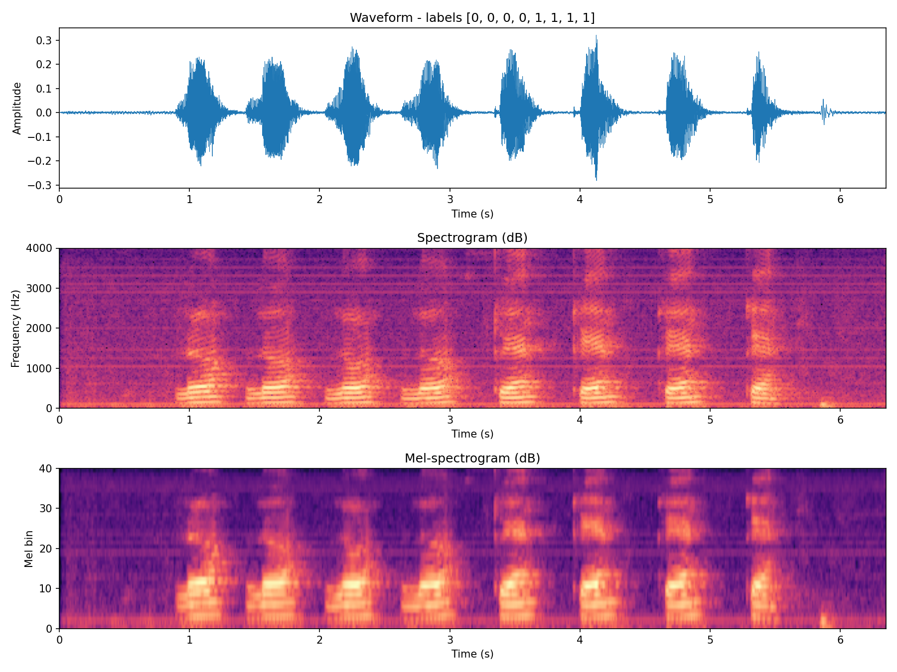
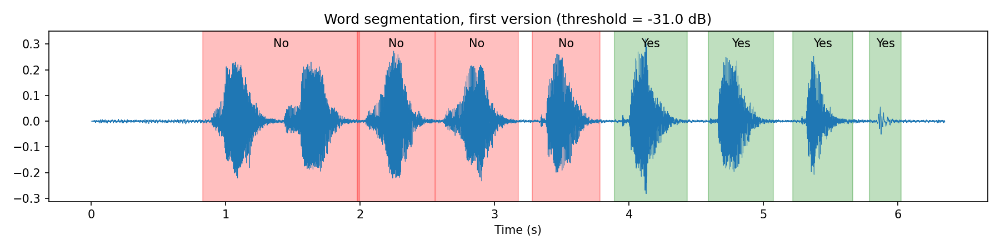
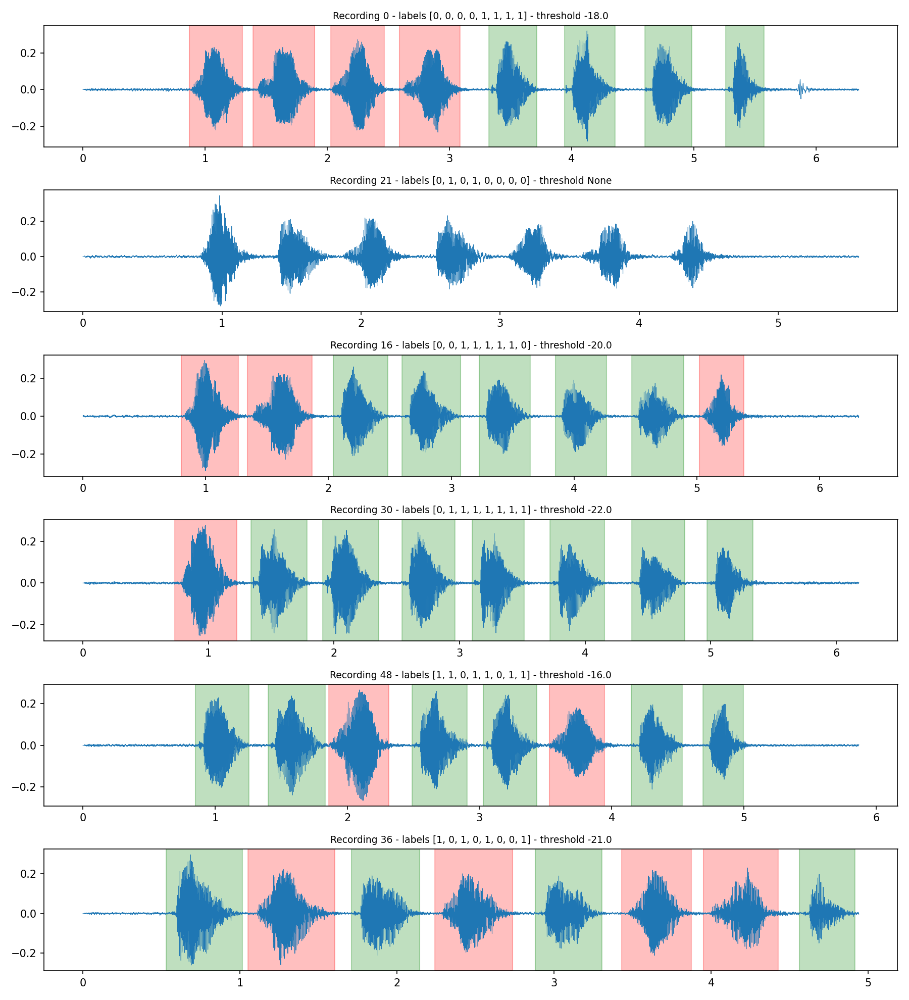
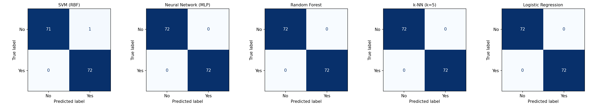
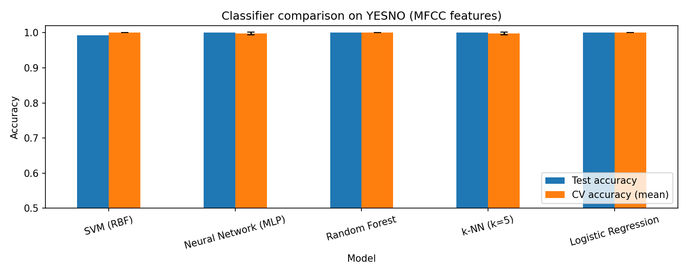
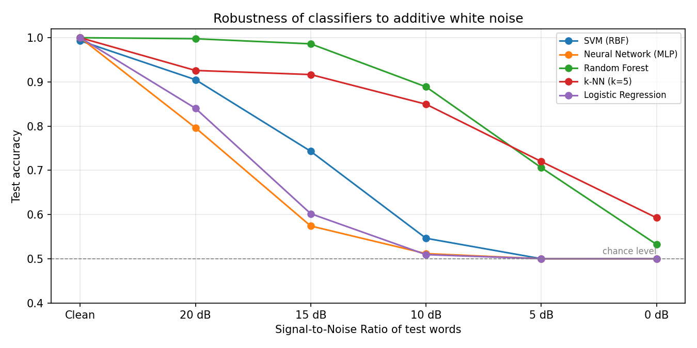

# Task 8: Yes/No Audio Classification

**Course:** Digital Speech Processing  
**Student:** Abbas Almijbilee (عباس المجبلي)  
**Student ID:** 404131082  
**Dataset:** YESNO (`torchaudio.datasets.YESNO`)  
**Notebook:** [`YesNo_Classification.ipynb`](YesNo_Classification.ipynb)

## 1. Goal

For this mini task I trained several classifiers on the YESNO dataset and compared how they perform. The idea was to go through the full pipeline myself: load the audio, look at the signal, sample rate and labels, plot the spectrogram, extract features, and then compare different models on the same data.

## 2. Dataset

YESNO comes with torchaudio. It has 60 recordings of a single male speaker saying 8 Hebrew words in each file. Each word is either "ken" (yes) or "lo" (no), and the labels are written in the file name, for example `0_0_0_0_1_1_1_1.wav`.

What I found when I loaded it:

| Property | Value |
|---|---|
| Recordings | 60 |
| Sample rate | 8000 Hz, mono |
| Recording length | 4.94 s to 6.98 s (mean 6.13 s) |
| Labels per recording | 8 (0 = No, 1 = Yes) |
| Total words | 480 (251 Yes, 229 No) |

The two classes are close to balanced (52% / 48%), so I used accuracy as the main metric, with F1 next to it.

In the waveform of the first recording you can clearly see 8 separate bursts with silence between them. The spectrogram shows a difference between the two words. The "No" words have most of their energy at low frequencies and change smoothly. The "Yes" words start with a sharp vertical stripe that covers almost the whole frequency range, which I think is the burst of the /k/ at the start of "ken", and they have more energy in the middle range (roughly 1500 to 2500 Hz). There are also faint horizontal lines across the whole recording (around 1100 Hz and several above 2800 Hz), which look like steady background hum from the recording setup. Near 5.9 s there is a small click after the last word, which turned out to matter in the next step.

For the spectrograms and the MFCC features I used a window of 256 samples (32 ms) and a hop of 80 samples (10 ms).

## 3. Word segmentation

Each file has 8 labels but only one audio signal, so before training I had to cut every recording into its 8 words. I used a simple energy-based method. I compute the short-time energy (25 ms frames, 10 ms hop) in dB, mark frames above a threshold as speech, and join the frames into regions.

**First attempt** (Step 3b in the notebook). My first version tried thresholds from low to high and took the first one that gave exactly 8 regions. This reported 59/60 recordings as segmented, but when I plotted the result it was wrong:

The first two words were merged into one region, and the small click at 5.9 s was counted as the last "Yes". The count was still 8, so the labels were shifted by one word without any error being raised. If I had not plotted it, the classifiers would have been trained on wrong labels. Another sign of the problem was that the longest "word" was 1.7 s, while a normal word is around 0.4 s.

**Improved version.** I changed the following:
1. A region only counts as a word if its peak energy is within 15 dB of the loudest frame in the recording. This removes clicks and background noise.
2. If any region is longer than 1 s, I reject that threshold, because it means two words were merged.
3. Instead of the first threshold that works, I collect all thresholds that give 8 valid regions and take the one in the middle of that range.
4. I reduced the minimum gap for joining two neighbouring regions from 100 ms to 50 ms, so that words with a short pause between them are not joined.

In both versions, regions shorter than 100 ms are ignored and each segment is padded by 50 ms on both sides.

With this version every word has a single colour and the colours match the labels. The click in recording 0 is no longer included. Segment lengths (including the padding) are now between 0.26 s and 0.56 s (mean 0.41 s), which makes sense for single words.

**Recording 21 (`0_1_0_1_0_0_0_0.wav`).** This was the only recording where segmentation failed. When I looked at it, I found that it only contains **7 spoken words**, while its file name has 8 labels. The last word ends at around 4.5 s and the rest of the file is silence, so the recording was not simply cut off; one word seems to be missing from the audio. There is no reliable way to know which of the 8 labels has no matching word, so I excluded this recording. The final data is **59 recordings and 472 words**.

## 4. Features and data split

For each word I computed 13 MFCCs (40 mel bands) and their deltas. To get a fixed-length vector for words of different lengths, I took the mean and standard deviation over time, which gives **52 features per word** (13 × 4).

I split the data **by recording, not by word**, using `GroupShuffleSplit` (70/30). Words from the same recording share the same conditions, so putting some of them in train and some in test would make the results look better than they really are.

| Split | Recordings | Words | Yes / No |
|---|---|---|---|
| Train | 41 | 328 | 177 / 151 |
| Test | 18 | 144 | 72 / 72 |

No recording appears in both sets. Features were standardized with a `StandardScaler` fitted on the training set only.

## 5. Classifiers

I compared five classifiers from scikit-learn:

| Model | Settings |
|---|---|
| SVM | RBF kernel, C = 1, gamma = "scale" |
| Neural Network (MLP) | two hidden layers (64, 32), max 1000 iterations |
| Random Forest | 200 trees |
| k-NN | k = 5 |
| Logistic Regression | default, max 1000 iterations |

Each model was trained on the training split and tested on the 18 held-out recordings. I also ran 5-fold cross-validation over all 59 recordings with `GroupKFold`, so that the comparison does not depend on a single split.

## 6. Results on clean data

| Model | Test accuracy | Test F1 | Errors (of 144) | CV accuracy (mean ± std) | Train time (s) |
|---|---|---|---|---|---|
| SVM (RBF) | 0.9931 | 0.9931 | 1 | 1.0000 ± 0.0000 | 0.010 |
| Neural Network (MLP) | 1.0000 | 1.0000 | 0 | 0.9979 ± 0.0042 | 0.148 |
| Random Forest | 1.0000 | 1.0000 | 0 | 1.0000 ± 0.0000 | 0.441 |
| k-NN (k=5) | 1.0000 | 1.0000 | 0 | 0.9979 ± 0.0042 | 0.001 |
| Logistic Regression | 1.0000 | 1.0000 | 0 | 1.0000 ± 0.0000 | 0.015 |

All five models are above 99%. SVM made one mistake on the test set (a "No" predicted as "Yes"), but it got 100% in cross-validation, so I see this as a single hard example rather than a weakness of the model. MLP and k-NN each made one mistake out of 472 words in cross-validation. k-NN was the fastest to train and Random Forest the slowest (0.44 s), but all of them are fast on a dataset this small. The training times change a little each time the notebook is run.

I expected this task to be easy, and the results confirm it. There is only one speaker, the two words sound very different, and the recordings are clean. Even Logistic Regression, the only linear model here, reached 100%, which suggests the two classes are almost linearly separable in MFCC space. The downside is that on clean data the comparison does not tell the models apart, because they all reach the ceiling.

## 7. Extra experiment: robustness to noise

To get a more useful comparison, I tested how the models behave when the test audio is noisy. I added white Gaussian noise to every test word at SNRs of 20, 15, 10, 5 and 0 dB. The signal power for the SNR was computed over the whole word segment, including the short padding. The models were **not retrained**; they were the same models trained on clean data. Each noise level was repeated with 3 different noise seeds and averaged.

| Model | Clean | 20 dB | 15 dB | 10 dB | 5 dB | 0 dB |
|---|---|---|---|---|---|---|
| SVM (RBF) | 0.9931 | 0.9051 | 0.7431 | 0.5463 | 0.5000 | 0.5000 |
| Neural Network (MLP) | 1.0000 | 0.7963 | 0.5741 | 0.5116 | 0.5000 | 0.5000 |
| Random Forest | 1.0000 | 0.9977 | 0.9861 | 0.8889 | 0.7060 | 0.5324 |
| k-NN (k=5) | 1.0000 | 0.9259 | 0.9167 | 0.8495 | 0.7199 | 0.5926 |
| Logistic Regression | 1.0000 | 0.8403 | 0.6019 | 0.5093 | 0.5000 | 0.5000 |

This experiment showed differences that the clean test could not:

- **Random Forest** was the most robust. It stayed at 99.8% at 20 dB and 98.6% at 15 dB, and only dropped to 88.9% at 10 dB.
- **k-NN** came second at moderate noise, but it was the best at very high noise (72.0% at 5 dB, 59.3% at 0 dB).
- **SVM, Logistic Regression and MLP** dropped quickly and ended at exactly 50%. Since the test set is balanced (72/72), an average of exactly 50% suggests that the model predicts the same class for every word (I check this below). MLP was the most sensitive and already fell to 79.6% at 20 dB.

My explanation is a mismatch between training and test conditions. White noise adds energy across all frequencies, so the MFCC values of noisy words move outside the range the models saw during training. Each model reacts to this differently:

- Logistic Regression and the MLP extend their decision boundary beyond the training data, so when all features shift in the same direction, every sample ends up on one side of it.
- For the RBF SVM, when a sample is far from all support vectors the kernel values become close to zero, so the output is decided almost only by the bias term, which would give the same class for every sample.
- Random Forest uses threshold rules on the most discriminative features, and its output does not keep changing outside the training range, so it is less affected.
- k-NN only looks at which training points are closest. My guess is that the noise moves the points in a fairly similar direction, so part of the neighbourhood structure is kept.

To check this, I also looked at which class each model predicts at 0 dB (one noise draw). SVM, MLP and Logistic Regression predicted "Yes" for 100% of the test words, which confirms that they collapse to a single class. Random Forest went the other way and predicted "Yes" for only 3% of the words, so at 0 dB its 53% is also close to a one-class answer. k-NN predicted "Yes" for 88% of the words. A possible reason why most models lean towards "Yes" is that white noise has the same energy at all frequencies, so compared with speech, whose energy is mostly at low frequencies, it raises the middle and high frequencies the most. In the clean data, the "Yes" words are the ones with more energy in that region and with the broadband /k/ burst, so noisy words look more like "Yes".

This experiment uses a single train/test split (144 test words), so small differences between models should not be over-interpreted.

## 8. Conclusions and limitations

- On clean data the task is almost solved by every classifier. MFCC mean/std features were enough to separate "ken" and "lo" for this speaker.
- Segmentation was the step that needed the most care. The first version passed a simple count check but produced shifted labels, and I only noticed this by plotting the result. Checking the segmentation visually also helped me find that recording 21 does not match its labels.
- Under noise, the ranking changes a lot: Random Forest and k-NN are clearly more robust than SVM, LR and MLP when trained on clean audio.
- Limitations: the dataset has a single speaker and only 59 usable recordings, so these results say little about speaker-independent recognition. I also only tested white noise, not real environmental noise.

Ideas for improving robustness, which also connect to the next task on VOiCES and VAD:
- training with noise-augmented data (multi-condition training),
- per-word feature normalization (CMVN),
- a better VAD or a denoising step before classification.

## 9. How to run

1. Open `YesNo_Classification.ipynb` in Google Colab (File → Upload notebook).
2. Run **Runtime → Run all**. The dataset (about 4.5 MB) downloads automatically to `./data`.
3. All figures are saved in `./figures`.

Libraries used: `torch`, `torchaudio` (+ `torchcodec` for audio loading), `scikit-learn`, `numpy`, `pandas`, `matplotlib`.
