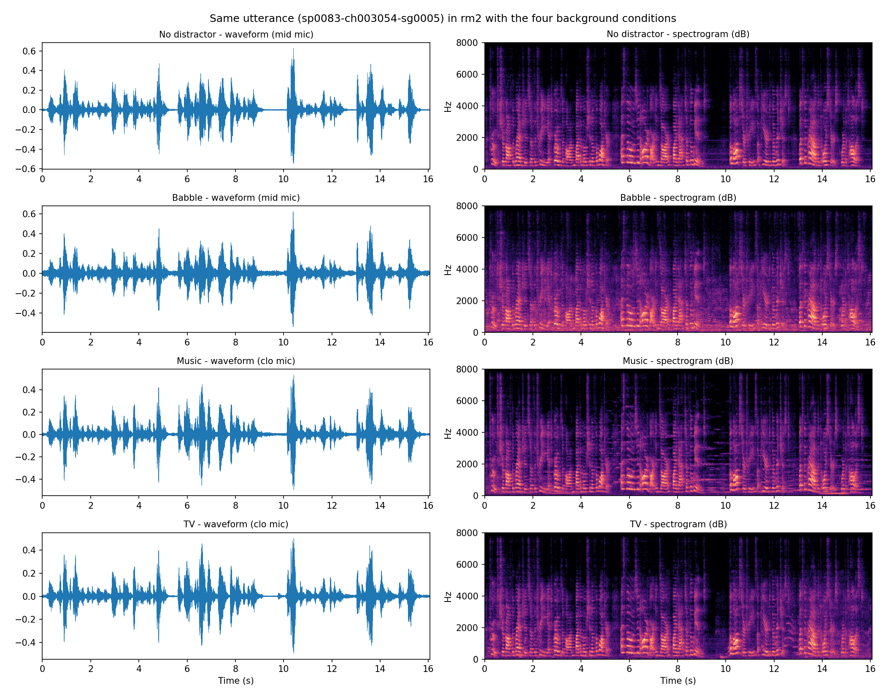
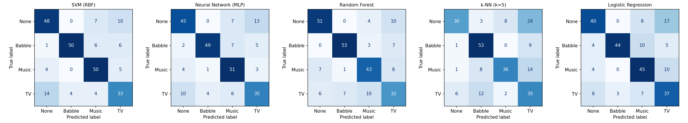
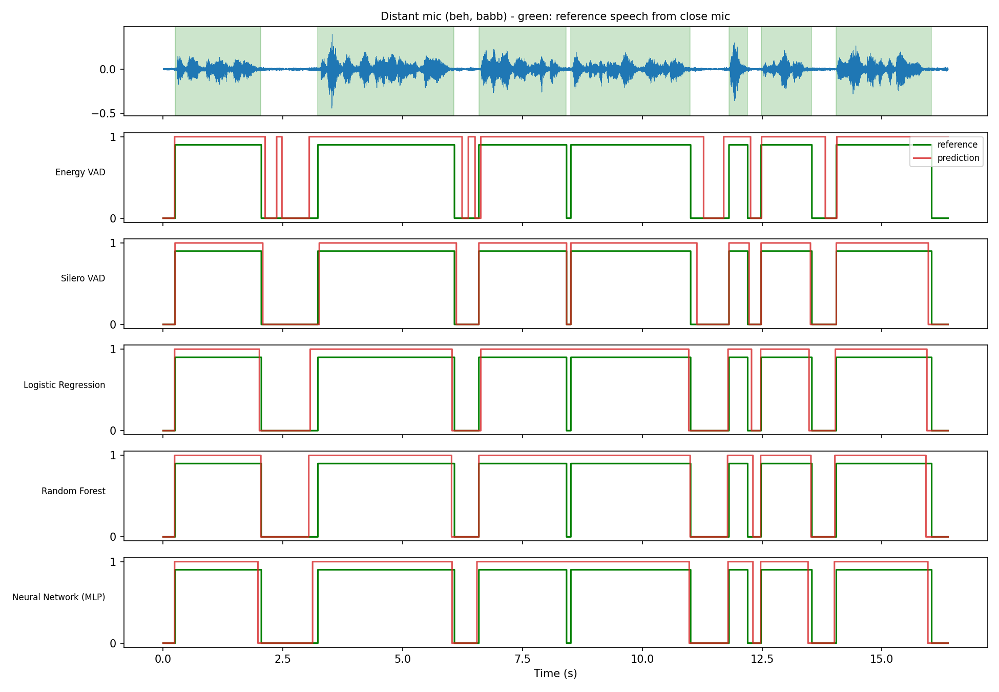
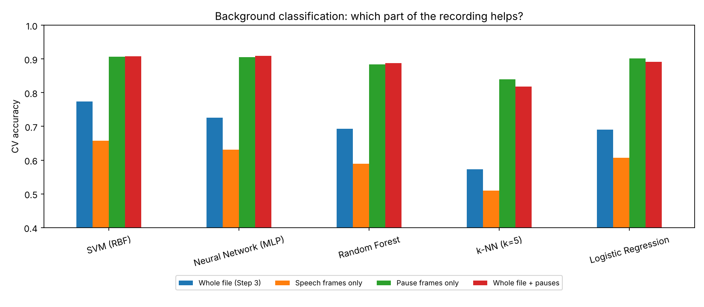

# Task 9: Event/Background Classification and Voice Activity Detection on VOiCES

**Course:** Digital Speech Processing  
**Instructor:** Dr. Mohammad Khalooei  
**Student:** Abbas Almijbilee (عباس المجبلي)  
**Student ID:** 404131082  
**Dataset:** VOiCES subset ([Lab41/VOiCES-subset](https://github.com/Lab41/VOiCES-subset))  
**Notebook:** [`VOiCES_Task.ipynb`](VOiCES_Task.ipynb)

## 1. Goal

This task has two parts on the VOiCES corpus:

1. **Event/background classification:** recognise which background sound is playing in a recording (none, babble, music or TV).
2. **Voice activity detection (VAD):** decide for every short frame whether there is speech in it or not.

At the end I also used the VAD output to improve the background classifier, which turned out to be the most interesting result of the task.

## 2. Dataset

VOiCES (Voices Obscured in Complex Environmental Settings) was recorded by SRI International and Lab41. Read speech from LibriSpeech was played through a loudspeaker inside real rooms and recorded with microphones at different positions, while other loudspeakers played a distractor sound at the same time. The full corpus is very large (about 418 GB, and even the official devkit is 27.5 GB), so I used the smaller **VOiCES-subset** that the instructor suggested. It only contains recordings where the foreground speaker is at the 90-degree position.

All the labels I needed are in the file names, for example
`Lab41-SRI-VOiCES-rm2-babb-sp1472-ch285314-sg0013-mc03-stu-mid-dg090.wav`
(room, distractor, speaker, chapter, segment, microphone, microphone type, microphone position, angle).

| Property | Value |
|---|---|
| Recordings | 908 |
| Sample rate | 16 kHz |
| Length | 2.66 s to 19.10 s (mean 15.56 s), 3.92 hours in total |
| Speakers / utterances | 104 / 128 |
| Distractors | none 227, babble 228, music 231, TV 222 |
| Rooms | rm1 446, rm2 462 |
| Microphones | mc01 close 251, mc03 mid 211, mc05 far 219, mc07 behind 227 |

The four background classes are balanced, so accuracy is a fair metric for the classification part.

## 3. What the backgrounds look like

To compare the backgrounds fairly, I picked one utterance (`sp0083-ch003054-sg0005`, room rm2) that exists with all four distractors and used the closest microphone available for each one (mid microphone for none and babble, close microphone for music and TV).

The speech itself looks almost the same in the four versions. The difference shows up mostly **in the pauses between phrases**. In the music version, the pause around 9 to 10 s has clear horizontal lines, which are musical tones. Babble raises the noise floor during the whole recording, mostly below about 4 kHz. In the version without a distractor, the pauses are almost empty. This observation is what I later used in Section 6.

## 4. Background classification

**Features.** For each recording I computed 20 MFCCs (512-sample window, 10 ms hop, 40 mel bands) and their deltas. I summarised them over the whole file with the mean and standard deviation of the MFCCs and the standard deviation of the deltas, which gives **60 features per file**.

**Split.** I split the data **by speaker**, so the test speakers never appear in training. Otherwise a model could partly recognise the speaker or the sentence instead of the background. 25% of the speakers went to the test set: 666 files from 78 speakers for training, and 242 files from 26 speakers for testing. I also ran 5-fold cross-validation grouped by speaker over all 908 files.

**Models.** SVM (RBF kernel, C = 1), MLP (hidden layers 128 and 64), Random Forest (300 trees), k-NN (k = 5) and Logistic Regression, each with standardised features.

| Model | Test accuracy | Test macro-F1 | CV accuracy (mean ± std) |
|---|---|---|---|
| SVM (RBF) | 0.7479 | 0.7453 | 0.7742 ± 0.0338 |
| Neural Network (MLP) | 0.7438 | 0.7418 | 0.7257 ± 0.0404 |
| Random Forest | 0.7397 | 0.7349 | 0.6927 ± 0.0366 |
| k-NN (k=5) | 0.6364 | 0.6354 | 0.5727 ± 0.0177 |
| Logistic Regression | 0.6860 | 0.6889 | 0.6905 ± 0.0407 |

SVM was the best model (74.8% on the test speakers, 77.4% in cross-validation). Chance level for four balanced classes is 25%, so all models clearly learn something, but the task is much harder than the Yes/No task. k-NN was the weakest model.

The confusion matrices show where the difficulty is:

- **TV is the hardest class.** SVM recognised only 33 of the 55 TV recordings, and 14 of them were predicted as "none". My explanation is that the TV sound itself often contains speech, so it is easy to mix up with the foreground speaker.
- **Babble and the clean condition are rarely confused.** A "none" recording was never predicted as babble by SVM, MLP, Random Forest or Logistic Regression, and at most 4 babble recordings were predicted as "none" (Logistic Regression). Babble raises the noise level for the whole recording, which is easy to see in the features.
- **Music** was recognised well (50 of 59 with SVM), probably because of its steady tonal components.

For the best model (SVM), the test accuracy per microphone position was 77.3% (close), 71.4% (mid), 75.0% (far) and 75.4% (behind). The microphone distance did not have a clear effect on this task.

## 5. Voice activity detection

### 5.1 Reference labels

VOiCES does not come with frame-level speech labels, so I had to build a reference. In the subset there are **108 cases** where the same utterance, in the same room and with the same distractor, was recorded at the same time by the close microphone (mc01) and by another microphone. Because both microphones recorded the same playback at the same time, the two files of a pair are aligned in time (the code also cuts both files to the shorter length). In all 108 pairs the other microphone is the one behind the speaker (mc07).

I ran **Silero VAD on the close microphone** and used its output as the reference for every 10 ms frame. The close microphone should have the best signal-to-noise ratio, so it is the most reliable signal I had for this. The methods were then tested on the **distant microphone** of each pair. In the reference, **86.3%** of the frames are speech.

I split the pairs by speaker: 78 pairs for training and 30 pairs for testing, with no shared speakers.

### 5.2 Methods

1. **Energy VAD.** A frame is speech if its energy is more than *k* dB above the noise floor (the 10th percentile of the frame energies in that recording), followed by a median filter over 11 frames (110 ms). I chose *k* on the training pairs by trying 0 to 20 dB; the best value was **1 dB**.
2. **Silero VAD** ([snakers4/silero-vad](https://github.com/snakers4/silero-vad), pretrained, default settings), run directly on the distant microphone.
3. **Trained frame classifiers.** For each 10 ms frame I used 20 MFCCs, 20 deltas and the frame energy relative to the loudest frame (41 values), together with the same values 5 frames before and after (123 features). I trained Logistic Regression, Random Forest (100 trees) and an MLP (64, 32) on 60,000 random frames from the training pairs, and smoothed the output with the same 11-frame median filter.

### 5.3 Results (30 test pairs, distant microphone)

Because 86% of the frames are speech, a "detector" that always says *speech* would already get **85.79%** accuracy on the test pairs. That is the baseline every method has to beat, and it is also why I report precision, recall and F1 for the speech class.

| Method | Accuracy | Precision | Recall | F1 |
|---|---|---|---|---|
| Always "speech" (baseline) | 0.8579 | – | – | – |
| Energy VAD | 0.9175 | 0.9423 | 0.9627 | 0.9524 |
| Silero VAD | 0.9842 | 0.9907 | 0.9909 | 0.9908 |
| Logistic Regression | 0.9504 | 0.9655 | 0.9771 | 0.9713 |
| Random Forest | 0.9571 | 0.9648 | 0.9859 | 0.9753 |
| Neural Network (MLP) | 0.9601 | 0.9705 | 0.9834 | 0.9769 |

F1 per distractor type:

| Method | none | babble | music | TV |
|---|---|---|---|---|
| Energy VAD | 0.976 | 0.947 | 0.941 | 0.954 |
| Silero VAD | 0.995 | 0.992 | 0.986 | 0.992 |
| Logistic Regression | 0.976 | 0.969 | 0.972 | 0.970 |
| Random Forest | 0.986 | 0.969 | 0.975 | 0.974 |
| Neural Network (MLP) | 0.987 | 0.971 | 0.973 | 0.981 |

- **Energy VAD** was the weakest method and had the lowest precision (94.2%). The best threshold was only 1 dB above the noise floor, so in practice it marks almost any sound louder than the quietest frames as speech. In the example above it ends most speech segments too late, starts some of them too early, adds short false detections inside the pauses (around 2.4 s and 6.4 s) and misses the short pause at about 8.4 s. It also suffered most from babble and music, which keep the energy high during the pauses.
- **The trained classifiers** were clearly better (accuracy 95% to 96%, F1 about 0.97). The MLP was the best of the three. Their predictions follow the reference closely, although some boundaries are a little early or late, and in the example they also miss the short pause at about 8.4 s, which Silero detects.
- **Silero VAD** got the highest scores (98.4% accuracy, F1 0.991). This result is **optimistic**, because the reference labels were also produced by Silero (on the close microphone). Silero is partly being compared with itself, so its advantage over the other methods should not be taken at face value.
- For all methods, the condition without a distractor was the easiest.

## 6. Using the VAD to improve background classification

In Section 3 I noticed that the background is easiest to see in the pauses. To test this, I ran Silero VAD on each of the 908 recordings and computed the same 60 features from the speech frames only and from the pause frames only. I also tried the whole-file features from Section 4 together with the pause features (120 values). If a file had fewer than 10 pause frames, I used the whole file for the pause features. On average, pauses were only **13.6%** of a recording (minimum 1.5%).

5-fold CV accuracy, grouped by speaker:

| Model | Whole file (Section 4) | Speech frames only | Pause frames only | Whole file + pauses |
|---|---|---|---|---|
| SVM (RBF) | 0.7742 | 0.6574 | 0.9064 | 0.9075 |
| Neural Network (MLP) | 0.7257 | 0.6309 | 0.9052 | 0.9086 |
| Random Forest | 0.6927 | 0.5891 | 0.8843 | 0.8877 |
| k-NN (k=5) | 0.5727 | 0.5099 | 0.8403 | 0.8183 |
| Logistic Regression | 0.6905 | 0.6067 | 0.9020 | 0.8921 |

This was the clearest result of the task:

- Using **only the pauses** improved every model by a large margin. SVM went from 77.4% to 90.6%, and Logistic Regression from 69.1% to 90.2%. This happened even though the pauses are only about 14% of the audio.
- Using **only the speech frames** was worse than using the whole file for every model. The foreground speech covers the background, so these features probably describe the speaker more than the distractor.
- Adding the whole-file features to the pause features did not really help: it changed the accuracy by less than 0.4 points for SVM, MLP and Random Forest, and made k-NN (−2.2 points) and Logistic Regression (−1.0 point) worse. Almost all the useful information is in the pauses.

So the VAD is not only a separate task here. Used as a first step, it removes the part of the signal that hides the background and makes the background classifier much better.

## 7. Conclusions and limitations

- Recognising the background from whole recordings is a fairly hard problem (best CV accuracy 77.4%). TV was the hardest class, probably because it also contains speech.
- For VAD on the distant microphone, trained classifiers on MFCC features were clearly better than a simple energy threshold (accuracy 95.0% to 96.0% against 91.8%, F1 0.971 to 0.977 against 0.952). Silero scored highest, but the comparison favours it because it also produced the reference.
- Combining the two parts gave the main result: computing the background features only on the pauses found by the VAD raised the accuracy of SVM from 77.4% to 90.6%. The best value overall was 90.9% (MLP with whole-file and pause features).

Limitations:

- The VAD reference comes from an automatic method (Silero on the close microphone), not from manual labels, so it can contain errors and is biased towards Silero. Babble and TV also contain speech-like sounds, which the reference may mark as speech even when the foreground speaker is silent.
- Only 108 close/distant pairs were available, all with the distant microphone behind the speaker, and the VAD test set has 30 pairs.
- I used the 90-degree subset only, so the results may be different for other speaker angles and microphone positions.

## 8. How to run

1. Open `VOiCES_Task.ipynb` in Google Colab (File → Upload notebook).
2. Run **Runtime → Run all**. The first cell clones the VOiCES subset (about 365 MB), and Step 4 installs `silero-vad`.
3. Figures are saved in `./figures`. Step 5 takes a few minutes, because Silero is run on all 908 recordings.

Libraries used: `torch`, `torchaudio`, `silero-vad`, `scikit-learn`, `scipy`, `numpy`, `pandas`, `matplotlib`, `soundfile`.

Reference: C. Richey et al., "Voices Obscured in Complex Environmental Settings (VOiCES) corpus", Interspeech 2018 (arXiv:1804.05053).
