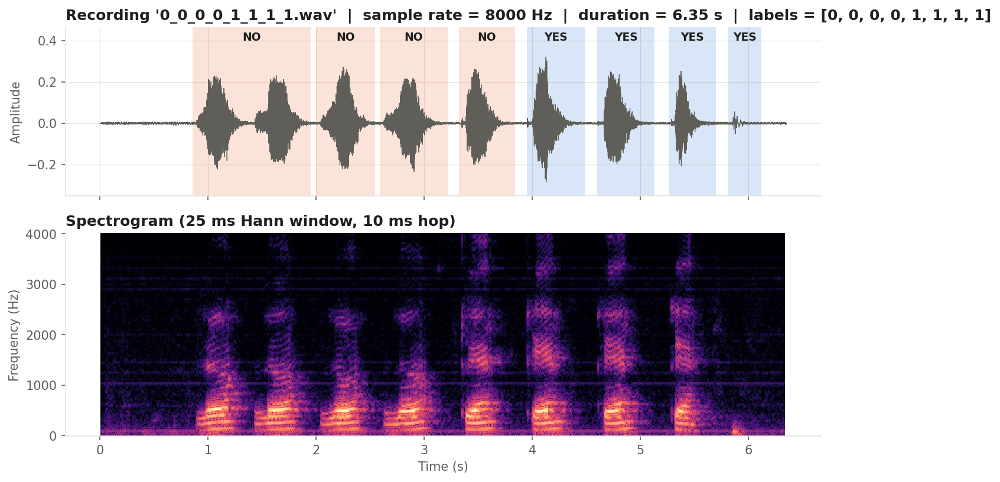
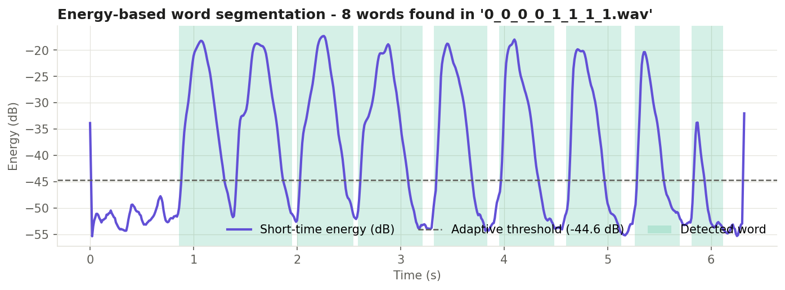
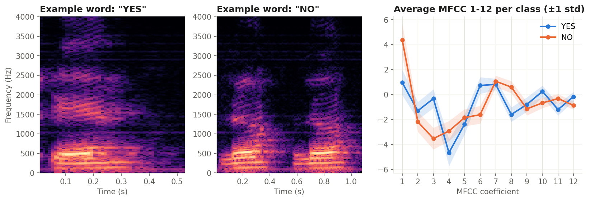
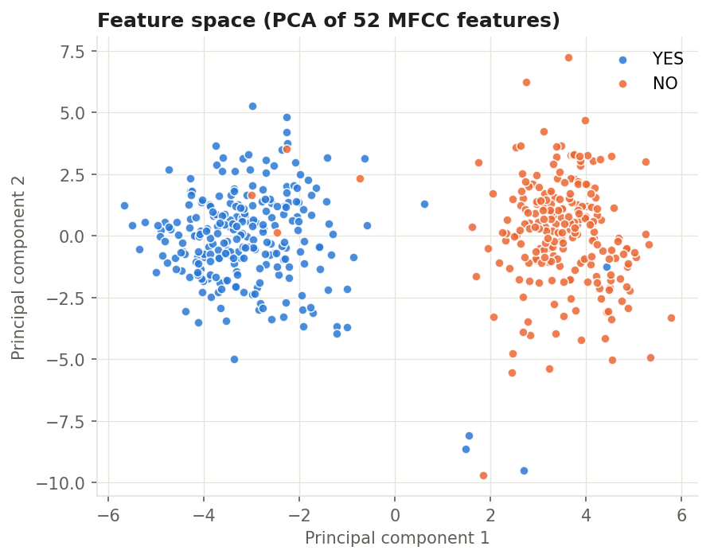
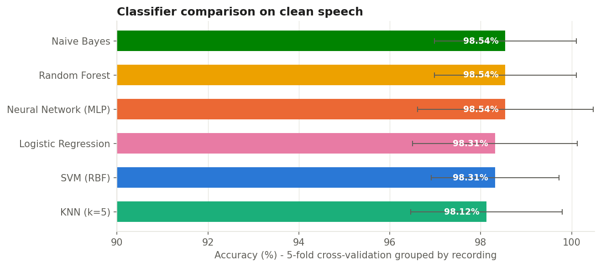
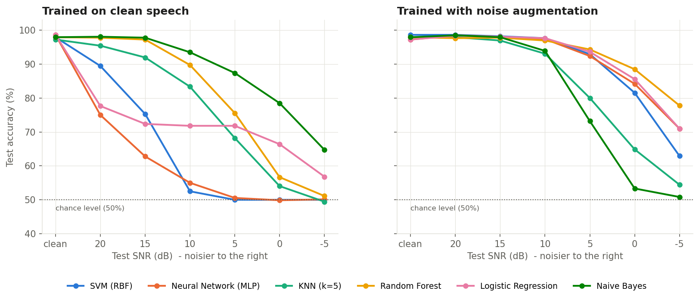
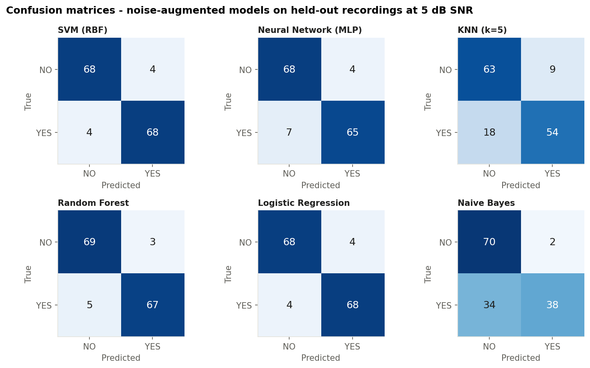
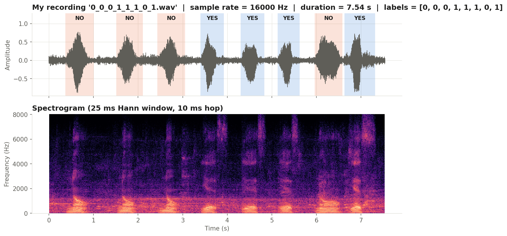
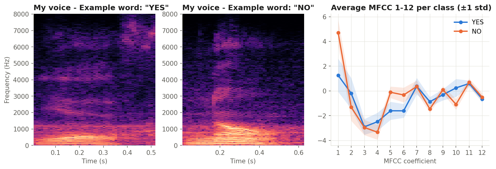
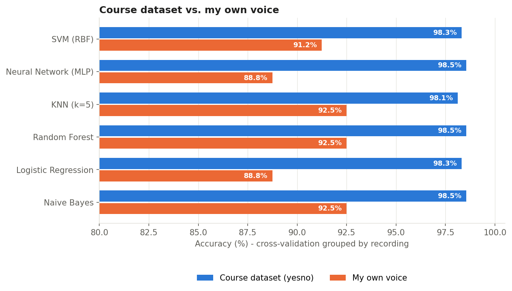

# Mini-Task 8 — Part 1: Spoken "Yes" / "No" Classification

**Course:** Digital Speech Processing — Dr. Khalooei
**Student:** Ghassan Alsafar — **ID:** 404131085

---

## 1. Goal

Classify isolated spoken words as **YES** or **NO**, compare several classifiers
(including **SVM** and a **Neural Network**), and report the results. Because
all models are close to perfect on clean audio, a **noise-robustness study** was
added to show which models really generalise, and the whole pipeline was also
run on **recordings of my own voice** (Part B, section 6).

## 2. Dataset — OpenSLR `yesno`

| Property | Value |
|---|---|
| Source | OpenSLR resource 1 (`waves_yesno.tar.gz`) |
| Recordings | 60 `.wav` files, one speaker |
| Words per recording | 8 (Hebrew *ken* = YES, *lo* = NO) |
| Sample rate | 8000 Hz, mono |
| Average duration | 6.13 s per recording |
| Labels | in the file name, e.g. `0_1_1_0_...wav` → NO, YES, YES, NO, … |
| Class balance | 249 YES / 223 NO words |



The waveform shows eight clear bursts of energy separated by silence; the
spectrogram shows that each word has its own formant pattern, which is what
the MFCC features capture.

## 3. Method

```
 .wav ─► energy-based word segmentation ─► 8 words ─► MFCC + ΔMFCC (52-dim) ─► classifier ─► YES / NO
```

### 3.1 Word segmentation (energy-based VAD)

1. Short-time energy in dB (25 ms frames, 10 ms hop), lightly smoothed.
2. Adaptive threshold between the noise floor (10th percentile) and the speech
   peak (99th percentile); several levels are tried and the one that yields
   exactly 8 words is kept.
3. Gaps shorter than 150 ms are merged, blobs shorter than 100 ms are dropped,
   30 ms of padding is added before each word and a 150 ms **hangover** after it
   (never past the middle of the pause), so weak word endings such as the /s/
   of English "yes" are not cut off.

**Result:** exactly 8 words were found in **59 of 60**
recordings. Recordings with a different count were excluded so that every word keeps its correct label: `0_1_0_1_0_0_0_0`.
Total words used: **472**.



### 3.2 Features — MFCC implemented from scratch

Pre-emphasis (0.97) → 25 ms Hamming frames → 512-point FFT → 26 Mel filters →
log → DCT → first 13 coefficients. Each word is summarised by the **mean and
standard deviation of the 13 MFCCs and of their deltas → 52 features**.





Even in two PCA dimensions the two classes form two clearly separated clusters,
so high accuracy is expected.

### 3.3 Classifiers

| Model | Settings |
|---|---|
| SVM | RBF kernel, C = 10, standardised features |
| Neural Network (MLP) | 2 hidden layers (64, 32), ReLU, Adam, L2 = 1e-3 |
| KNN | k = 5, standardised features |
| Random Forest | 200 trees |
| Logistic Regression | L2, standardised features |
| Naive Bayes | Gaussian |

### 3.4 Evaluation protocol

* **Grouped 5-fold cross-validation by recording** — all 8 words of a recording
  are always in the same fold, so the test set never contains words from a
  recording seen during training.
* A fixed **70 / 30 split by recording** (41 train /
  18 test recordings) is used for the noise study.
* **Noise study:** white Gaussian noise is added to the test words at
  SNR = 20, 15, 10, 5, 0, −5 dB (average of 5 random noise draws).
  Two training conditions are compared: *clean only* and *multi-condition*
  (each training word is also added once with noise at a random SNR between
  0 and 20 dB).

## 4. Results

### 4.1 Clean speech — 5-fold grouped cross-validation

| Model | Accuracy (%) | Macro-F1 (%) | Training time (ms) |
|---|---:|---:|---:|
| SVM (RBF) | 98.31 ± 1.41 | 98.31 | 11.1 |
| Neural Network (MLP) | 98.54 ± 1.93 | 98.54 | 550.0 |
| KNN (k=5) | 98.12 ± 1.67 | 98.12 | 3.6 |
| Random Forest | 98.54 ± 1.56 | 98.54 | 983.8 |
| Logistic Regression | 98.31 ± 1.81 | 98.31 | 11.7 |
| Naive Bayes | 98.54 ± 1.56 | 98.54 | 4.5 |



Best on clean speech: **Neural Network (MLP)**, **Random Forest**, **Naive Bayes** (tied) — 98.54%.

### 4.2 Noise robustness — test accuracy (%)

**Trained on clean speech**

| Model | clean | 20 dB | 15 dB | 10 dB | 5 dB | 0 dB | -5 dB |
|---|---:|---:|---:|---:|---:|---:|---:|
| SVM (RBF) | 97.9 | 89.4 | 75.3 | 52.5 | 50.0 | 50.0 | 50.0 |
| Neural Network (MLP) | 98.6 | 75.0 | 62.8 | 55.0 | 50.6 | 49.9 | 50.1 |
| KNN (k=5) | 97.2 | 95.4 | 91.9 | 83.3 | 68.2 | 54.0 | 49.4 |
| Random Forest | 97.9 | 97.8 | 97.2 | 89.7 | 75.6 | 56.7 | 51.1 |
| Logistic Regression | 98.6 | 77.6 | 72.4 | 71.8 | 71.8 | 66.4 | 56.8 |
| Naive Bayes | 97.9 | 98.1 | 97.8 | 93.5 | 87.4 | 78.5 | 64.7 |

**Trained with noise augmentation (multi-condition)**

| Model | clean | 20 dB | 15 dB | 10 dB | 5 dB | 0 dB | -5 dB |
|---|---:|---:|---:|---:|---:|---:|---:|
| SVM (RBF) | 98.6 | 98.6 | 98.2 | 97.6 | 92.9 | 81.5 | 62.9 |
| Neural Network (MLP) | 97.2 | 98.5 | 98.1 | 97.4 | 92.4 | 84.2 | 71.0 |
| KNN (k=5) | 97.9 | 97.9 | 96.9 | 93.1 | 80.0 | 64.9 | 54.4 |
| Random Forest | 97.9 | 97.6 | 97.8 | 96.9 | 94.3 | 88.5 | 77.8 |
| Logistic Regression | 97.2 | 98.3 | 98.1 | 97.6 | 93.6 | 85.6 | 71.0 |
| Naive Bayes | 97.9 | 98.5 | 97.9 | 93.9 | 73.2 | 53.3 | 50.8 |



Confusion matrices of the noise-augmented models on the held-out recordings at 5 dB SNR:



## 5. Discussion

1. **The clean task is easy.** Two words from one speaker in a quiet room are
   well separated by MFCCs (see the PCA plot), so most classifiers reach
   (almost) 100 %. Clean accuracy alone therefore cannot rank the models.
2. **Noise separates the models.** Averaged over all noise levels (20 → −5 dB)
   with clean training, **Naive Bayes** is the most robust
   (86.6% mean accuracy) and **Neural Network (MLP)** degrades the most
   (57.2%). Noise fills the silent parts and the high
   frequencies of each word, which shifts the MFCC statistics away from what a
   clean-trained model has seen.
3. **Noise augmentation helps a lot.** Adding noisy copies of the training words
   raises the mean noisy-test accuracy by **+15.8 points** on average over
   all models; the most robust model in that setting is **Random Forest**
   (92.2% mean, 88.5% at 0 dB).
4. **SVM vs Neural Network.** Both are at the top on clean speech; under noise,
   SVM reaches 81.5% and the MLP 84.2%
   at 0 dB (multi-condition training). With only 472 training words the
   small MLP has little data to learn from; a larger, multi-speaker dataset would
   be needed for a neural network to show a clear advantage over the SVM.

**Limitations.** One speaker and only two words; white noise only; word
boundaries for the noise study come from the clean signal. Next steps: more
speakers (e.g. Google Speech Commands), real background noise (babble, music)
and spectrogram-based CNNs.

## 6. Part B — My own voice

The same pipeline was run on recordings of **my own voice**, so the models are
tested on a new speaker, a new language (English *yes* / *no* instead of Hebrew
*ken* / *lo*) and a real phone microphone.

| Property | Value |
|---|---|
| Recordings | 10 files × 8 words = 80 words (40 YES / 40 NO) |
| Words | English "yes" and "no", read from a fixed random script |
| Recording device | mobile phone (Telegram voice note, Opus 48 kHz), converted to 16000 Hz mono WAV |
| Environment | everyday surroundings, not a studio |
| File names | same format as the course dataset, e.g. `1_0_0_1_1_0_1_0.wav` |
| Segmentation | exactly 8 words found in **10 of 10** recordings |





In my recordings the English **"yes"** ends with the fricative **/s/**, which is
visible as a weak burst of high-frequency energy (about 4–8 kHz) at the end of
most YES words in the spectrogram; **"no"** is a voiced word with energy mainly below 1 kHz. This is a
different cue from the Hebrew words in the course dataset, so the Part A models
cannot be reused directly — each model was trained and tested again on my voice
with the same grouped cross-validation (5 folds, whole
recordings held out).

| Model | Course dataset acc. (%) | My voice acc. (%) | My voice Macro-F1 (%) |
|---|---:|---:|---:|
| SVM (RBF) | 98.31 | 91.25 ± 5.00 | 91.25 |
| Neural Network (MLP) | 98.54 | 88.75 ± 4.68 | 88.73 |
| KNN (k=5) | 98.12 | 92.50 ± 4.68 | 92.49 |
| Random Forest | 98.54 | 92.50 ± 4.68 | 92.49 |
| Logistic Regression | 98.31 | 88.75 ± 4.68 | 88.73 |
| Naive Bayes | 98.54 | 92.50 ± 4.68 | 92.49 |



Best on my voice: **KNN (k=5)**, **Random Forest**, **Naive Bayes** (tied)
— 92.50%.

Accuracy on my voice is lower than on the course dataset, and the reasons are
clear: only 80 words (about 6× fewer), a phone microphone with a
compressed voice-note codec, background sound from the room, and a weak /s/ that
carries much of the YES/NO difference but is only a small part of each word's
averaged MFCCs. The results also vary more from fold to fold (see the ± values),
so more recordings would give a more reliable ranking. Next steps: record more
words, add frame-level features (e.g. a CNN on the spectrogram) so that short
cues like /s/ count more, and apply the noise augmentation from Part A.

## 7. How to run

```bash
pip install -r requirements.txt
python yesno_classification.py
```

The script downloads the data (~4.5 MB), then writes every figure to
`figures/`, every number to `results/results.json`, and regenerates this README.
Run time: about one minute on a laptop.

## 8. Files

```
MiniTask08_YesNo/
├── yesno_classification.py   # the whole pipeline
├── requirements.txt
├── README.md                 # this report (auto-generated)
├── MiniTask08_YesNo.ipynb    # notebook that runs the pipeline and shows the results
├── my_voice/                 # Part B: my own 10 recordings (80 words)
├── figures/                  # all figures
└── results/results.json      # all numbers
```

*Environment: Python 3.13.9, scikit-learn 1.7.2,
NumPy 2.3.5.*
